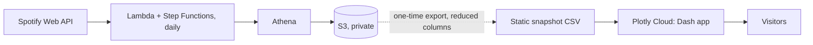

# Spotify Listening Behaviour Dashboard

Multi-page Plotly Dash dashboard that visualizes my own Spotify listening history (Summary, Review, Compare).

**Live demo:** [https://fe459d83-163f-41d7-954f-0ec3260ff687.plotly.app](https://fe459d83-163f-41d7-954f-0ec3260ff687.plotly.app) (static snapshot of my listening history up to 16 July 2026, hosted on a free plan: the first load after a pause may take up to ~30 s while the app wakes up).

## Architecture



- A daily AWS pipeline collects my listening history from the Spotify API and stores it as CSV in a private S3 bucket.
- The live demo does not read from AWS. It ships with one snapshot of that data, reduced to the columns the dashboard needs. Dates are anchored to the latest play in the data ("Snapshot of" in the header).
- The Dash code is shared: with AWS credentials in the environment it reads the pipeline output from S3 (read-only IAM policy in `aws/resources/s3_read_policy.json`), otherwise it reads the bundled snapshot.

## Run locally

```bash
python spotify_dashboard/app.py   # reads data/full_data_*.csv unless AWS_* env vars are set
```

Deployment steps: [docs/infrastructure.md](docs/infrastructure.md).
