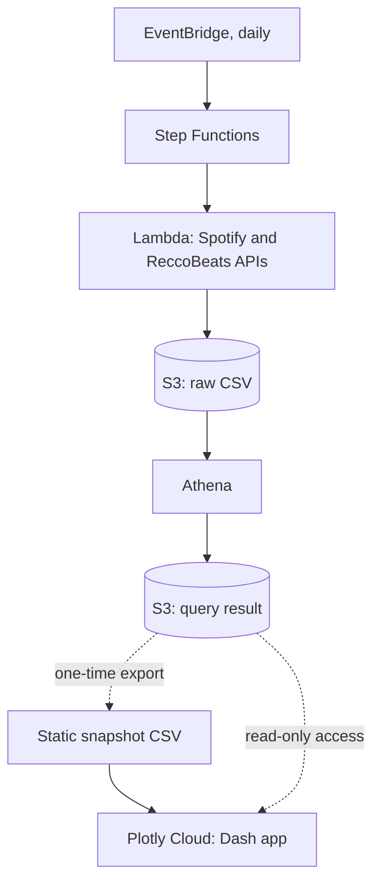
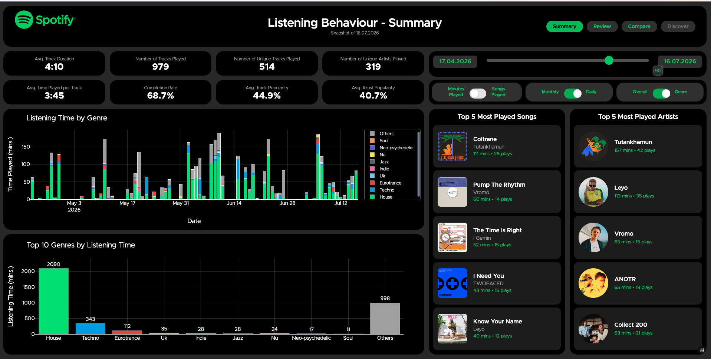
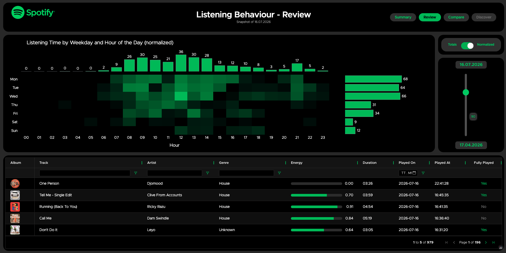
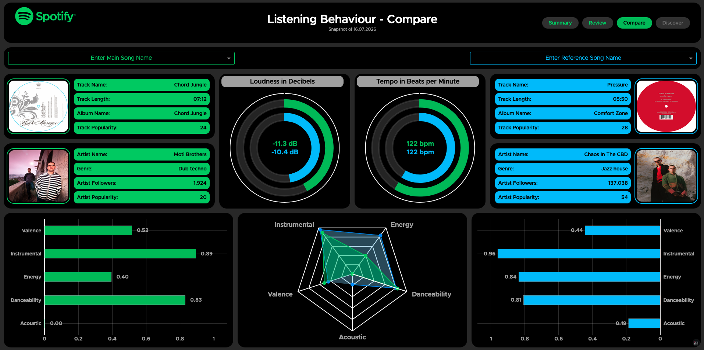

# Spotify Listening Behaviour Dashboard

Multi-page Plotly Dash dashboard on my own Spotify listening history, fed by a daily AWS pipeline.

## Live demo

The demo is a static snapshot of my listening history up to 16th July 2026:

[https://spotify_listening_behaviour.plotly.app](https://fe459d83-163f-41d7-954f-0ec3260ff687.plotly.app)

__NOTE:__ When clicking on the link, it will take roughly __*30 sec*__. for the dashboard to load, as it runs on a free plan in Plotly Cloud with limited compute resources.

## Architecture



Once a day, a Step Functions state machine fetches my recently played tracks from the Spotify API, adds audio features from the ReccoBeats API, and stores the result as CSV in S3. An Athena query then writes one combined CSV to an S3-bucket for the dashboard to consume from Plotly Cloud.

__Note:__ The description above holds for a private version of the dashboard. The public demo that is linked above, reads from a static snapshot of the data that is hosted in Plotly Cloud.

Details: [docs/pipeline.md](docs/pipeline.md).

## Pages

**Summary**: KPIs, listening time over time (optionally split by genre), top genres, and the top 5 songs and artists for a selectable time window.



**Review**: heatmap of listening time by weekday and hour of the day (totals or normalized) and a filterable table of individual plays.



**Compare**: side-by-side comparison of two songs, with track and artist details, loudness, tempo and audio features.



## Built with

- AWS: EventBridge, Step Functions, Lambda, S3, Athena, IAM, Secrets Manager
- Python, pandas 2.2.3, Plotly 6.5.0, Dash 3.3.0
- Plotly Cloud (hosting)

## Run locally

```bash
python spotify_dashboard/app.py   # reads data/full_data_*.csv unless AWS_* env vars are set
```

## Further documentation

- [docs/pipeline.md](docs/pipeline.md): how the daily data pipeline works
