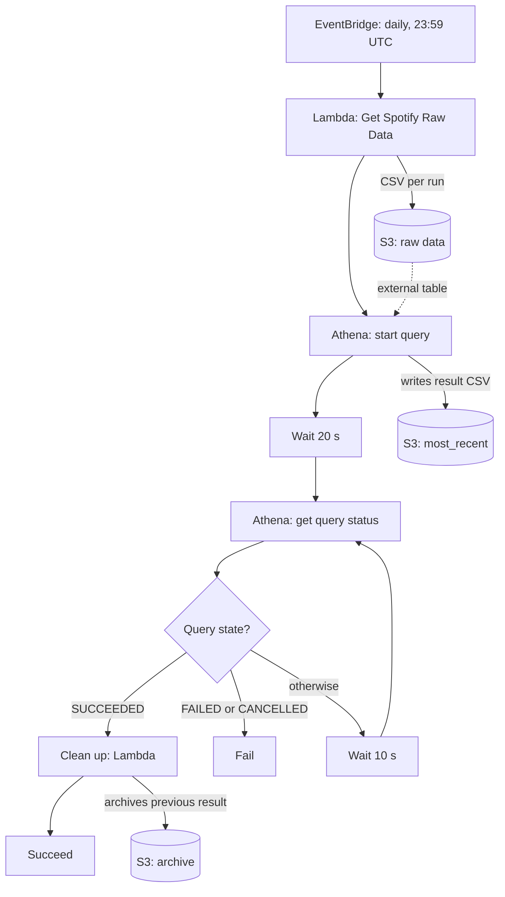

# Data pipeline

A daily AWS pipeline collects my Spotify listening history and prepares it for the dashboard. It runs as an AWS Step Functions state machine that chains two Lambda functions and an Athena query. This document explains how it works. It is not a setup guide.



## Daily run, step by step

### 1. Trigger

EventBridge starts the state machine once a day at 23:59 UTC.

### 2. Fetch and enrich

The Lambda "Get Spotify Raw Data" ([aws/lambda/src/get_spotify_data.py](../aws/lambda/src/get_spotify_data.py)):

1. Reads the Spotify credentials and refresh token from AWS Secrets Manager and exchanges the refresh token for an access token.
2. Calls the Spotify "recently played" endpoint (limit 50, plays from the last day).
3. Enriches the plays:
   - Source: Spotify
        - artist details, looked up by the first artist of each track
        - album details, requested in batches of 20 album IDs
   - Source: ReccoBeats
        - audio features requested in batches of 40 track IDs
4. Merges everything into one dataframe and writes it as one CSV per run to a private S3 bucket ([aws/lambda/src/aws_utils.py](../aws/lambda/src/aws_utils.py)).

This results in one extract (i.e. csv-file) per day that, when combined, form the entire listening history on Spotify (since data collection started).

### 3. Query with Athena

The state machine starts an Athena query in a dedicated workgroup:

```sql
SELECT * FROM spotifylisteningbehaviour.rawdata WHERE id != 'id'
```

`rawdata` is an external table over the raw CSVs ([aws/athena/slb_CreateOutputTable.sql](../aws/athena/slb_CreateOutputTable.sql)). The filter drops the header row that each CSV file contributes. The result is one consolidated CSV in S3 that combines all csv's created under step 2 (Fetch and enrich) to form the entire listening history.

### 4. Wait for the query (buffer)

The state machine waits 20 s and reads the query status. Then it branches:

- `SUCCEEDED`: continue with the clean-up.
- `FAILED` or `CANCELLED`: go to a fail state.
- Anything else: wait 10 s and check again.

### 5. Clean up

The Lambda "Move Athena Results To Archive" ([aws/lambda/src/move_to_archive.py](../aws/lambda/src/move_to_archive.py)):

1. Moves the previous query result from the `most_recent` prefix to an `archive` prefix.
2. Keeps only the newest file in `most_recent`.
3. Keeps only the newest 5 files in the archive. Combined files older than that get deleted to avoid cluttering of the S3 bucket. 

The dashboard can therefore always read the newest CSV under `most_recent`.

## Error handling

- Both Lambda steps retry on any error: 3 attempts, 2 s initial interval, backoff rate 2.
- A failed or cancelled Athena query ends the run in an explicit fail state.
- Calls to the ReccoBeats API retry up to 3 times with exponential backoff (1 s, 2 s, 4 s). After that the run continues without audio features.

## Where the data ends up

The newest CSV under `most_recent` is the input of the private dashboard. The private dashboard reads it from Plotly Cloud via a read-only IAM user. The public deployment (i.e. the one shown via the demo link in the repo's README) ships a one-time snapshot instead.

## Packaging

The Lambda dependencies are shipped as a Lambda layer built for Python 3.13 ([aws/lambda/lambda_layers/](../aws/lambda/lambda_layers/)).
